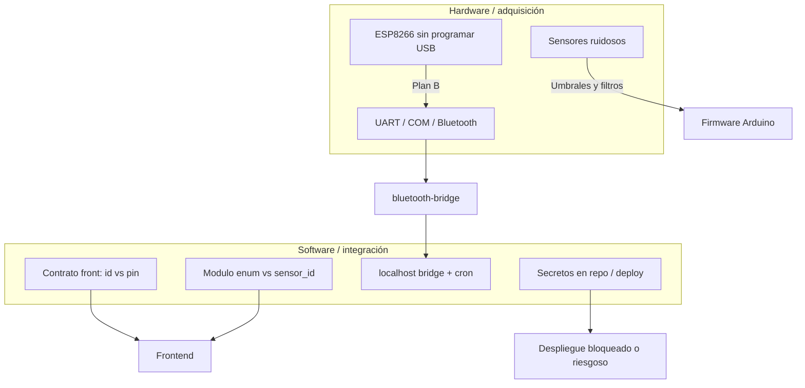

# Dificultades del desarrollo HCI y lecciones aprendidas

Este documento recoge **problemas reales y riesgos** encontrados durante el proyecto: los que describes explícitamente (Wi‑Fi, Bluetooth, sensores, despliegue, integración front‑back) y **otros derivados del código y la arquitectura** que suelen aparecer en este tipo de sistemas. Sirve como memoria de equipo y como guía para quien continúe el trabajo.

---

## 1. Comunicación hardware → internet: del Wi‑Fi al Bluetooth

### 1.1 Situación original (ESP8266 + adaptador)

La arquitectura pensada (y documentada en `docs/HARDWARE_ARCHITECTURE.md` y `docs/CIRCUIT_CONNECTIONS.md`) era clásica:

- **Arduino** como cerebro de sensores.
- **ESP8266 (ESP‑01) en adaptador** como “antena”: leería por **UART** el JSON que emite el Arduino y haría **HTTP POST** directo al backend en la nube o en la red local.

**Dificultad:** no se pudo conseguir el **adaptador USB‑TTL / programador** adecuado (o el cable/dispositivo necesario) para **flashear y configurar** el firmware del ESP8266 en tiempo útil del proyecto. Sin programar el módulo Wi‑Fi, esa ruta quedó **bloqueada**: el ESP no podía asumir el rol de cliente HTTP de forma fiable.

### 1.2 Decisión de contingencia: Bluetooth HC‑05

Se adoptó el **plan B** ya contemplado en la documentación de circuito: **módulo Bluetooth serie (HC‑05)** conectado al `Serial1` del Arduino, a **9600 baudios**, y una **PC intermedia** que hace de puente.

**Consecuencias (no son “gratis”):**

| Aspecto | Dificultad |
|--------|------------|
| **Dependencia de una PC** | El hogar o el laboratorio necesita un ordenador **encendido** con `bluetooth-bridge.js`; no es un dispositivo embebido autónomo como un ESP ya programado. |
| **Puerto COM exclusivo** | En Windows, el puerto Bluetooth “saliente” solo puede ser usado por **un proceso**. Si el Monitor Serie del Arduino IDE o PuTTY abre el mismo COM, el **bridge falla** o no recibe datos. |
| **Emparejamiento y drivers** | Emparejar HC‑05, PIN, dos COM (entrada/salida), elegir el COM correcto: fricción habitual en talleres y demos. |
| **Doble canal de depuración** | El firmware usa `Serial` (115200) y `Serial1` (9600): hay que tener claro **qué cable va a qué** para no mezclar baudios o pines. |
| **Bidireccionalidad** | El mismo canal sirve para **subir eventos** y para **bajar** `NOTIFY_MED` / `NOTIFY_ACT`: cualquier error de cableado RX/TX cruzado corta **solo una dirección** y el síntoma es confuso (“el backend dice que envió pero el Arduino no reacciona”). |

**Lección:** cuando el hardware de red no se puede programar, un **bridge en software** sobre PC es válido para **prototipo y tesis**, pero hay que documentar muy bien el arranque (orden: Mongo → Nest → bridge → Arduino) y asumir que **no es producción** sin reemplazar por Wi‑Fi, 4G o gateway dedicado.

---

## 2. Backend y paso de datos al frontend

El backend (NestJS + MongoDB) y el frontend (p. ej. Next.js, **fuera de este repo**) deben acordar **contratos estables**. En la práctica aparecieron varias fuentes de fricción.

### 2.1 Forma del payload desde el Arduino

- El Arduino envía `modulo` en **inglés minúsculas** (`activity`, `medication`, `ritual`) y un objeto `data` con `sensor_id`, `estado` y a veces **campos extra** concatenados como fragmento JSON en string.
- El bridge **remapa** módulos antes del POST.
- NestJS aplica **`canonicalEventModulo`** (`src/common/event-modulo.util.ts`) para guardar en mayúsculas alineado al enum del esquema.

**Dificultad:** si el front asumía nombres distintos (`MEDICATION` vs `MEDICACION`, o `activity` sin normalizar), las tarjetas o filtros **no coincidían** con lo guardado en MongoDB.

### 2.2 Enum de `Event.modulo` vs semántica real

En el esquema de eventos existen categorías como `SEDENTARISMO`, pero el firmware actual manda muchas alertas de sofá bajo **`ACTIVIDAD`** con `sensor_id: sofa_ultrasonic` y `estado: sedentary_alert`.

**Dificultad:** el front que solo mire `modulo === 'SEDENTARISMO'` **no vería** la alerta de sedentarismo; hace falta lógica por **`sensor_id` + `estado`** (como ya hace en parte `AnalyticsService` en el dashboard).

### 2.3 Identificador del anciano: ObjectId vs PIN

- `GET /events/elder/:id` está pensado en torno al **`ObjectId`** del anciano en MongoDB.
- En cambio, rutas como **`GET /analytics/dashboard/:elderId`** llaman internamente a **`findByPin`** con ese parámetro: el nombre de ruta dice `elderId` pero el valor esperado es el **PIN de vinculación** (ej. el token tipo `CASA10`).

**Dificultad:** el equipo de front puede construir URLs con el ID de Mongo y obtener **404** o datos vacíos en analytics, o al revés. Es un **contrato ambiguo** que obliga a documentar muy explícitamente qué endpoint usa **qué tipo de clave**.

### 2.4 Recordatorios y zona horaria

`RemindersService` compara la hora del servidor (`Date` local del proceso Node) con strings `hora` en BD usando `startsWith('HH:mm')`.

**Dificultades típicas:**

- El servidor en la nube en **UTC** vs usuario en **Colombia/Europa**: los recordatorios saltan a la hora “equivocada” si nadie normaliza zona horaria.
- Medicaciones exigen `hora` con regex **`^\d{2}:\d{2}$`**; recordatorios son `string` más laxo: **inconsistencia** entre colecciones si el front envía `"14:30:00"` en un sitio y `"14:30"` en otro (puede funcionar por `startsWith`, pero confunde validación y UI).

### 2.5 CORS y entornos

Con el front en `http://localhost:300X` y Nest en `http://localhost:3000`, en cuanto se separan **puertos u orígenes**, el navegador exige **CORS** bien configurado en NestJS. Si no estaba previsto desde el inicio, aparecen errores opacos en la consola del navegador (“blocked by CORS policy”).

### 2.6 `data` libre (`any`)

El campo `data` en eventos es **flexible** (cualquier objeto). Eso acelera el prototipo pero **dificulta** TypeScript en el front y contratos OpenAPI: hay que **documentar** los pares `sensor_id` / `estado` o generar tipos compartidos (paquete común, JSON Schema, etc.).

### 2.7 Rutas de usuarios y orden en NestJS

En `UsersController` conviven rutas como `GET :id/settings`, `GET :email`, `GET :id`. Según el orden de declaración, un segmento dinámico puede **interceptar** otra ruta (p. ej. un email mal interpretado como `id`). Eso genera **bugs intermitentes** difíciles de reproducir si el QA no prueba todos los patrones de URL.

**Lección:** unificar convenciones (`/users/by-email/...`, `/users/:id/...`) y pruebas e2e mínimas sobre las rutas más usadas por el front.

---

## 3. Sensibilidad y fiabilidad de sensores

Los sensores “baratos” y el entorno doméstico introducen ruido; el firmware muestra **varias capas de mitigación**, señal de que hubo ensayo y error.

### 3.1 PIR (movimiento)

- **Calibración bloqueante de 30 s** al arranque: el sistema no hace nada útil durante ese tiempo; en demo corta es incómodo, pero reduce falsos disparos al inicio.
- Lógica de **pausa** (`pause` ms tras LOW) para decidir “fin de movimiento”: demasiado corta → eventos repetidos; demasiado larga → sensación de “lag” en presencia.

### 3.2 Vibración (SW‑420 en pastillero)

Los golpes de mesa o manipulación brusca pueden disparar el sensor. En el código aparece **`pollVibrationSensitive()`**: rachas de lecturas HIGH, tiempo mínimo entre detecciones, y lógica especial cuando hay **notificación de medicación** activa para no mezclar “vibración casual” con el flujo del tótem.

**Dificultad:** equilibrar **sensibilidad** (detectar toma real) vs **robustez** (no registrar diez tomas por una sacudida).

### 3.3 HC‑SR04 (sofá)

- Ultrasónico sufre **eco**, objetos laterales, textiles que absorben, y **`pulseIn` con timeout** (25 ms en el código): a veces devuelve distancia inválida o −1.
- Umbral **50 cm** para “sentado”: depende de altura del sensor, del sofá y de la postura; calibrar en campo es obligatorio.

### 3.4 VL53L0X (nevera)

La documentación antigua hablaba de umbrales en **cm**; el firmware usa **> 300 mm** como “puerta abierta”. Ese cambio refleja típicamente: **puerta que no abre del todo**, marco metálico, o necesidad de más sensibilidad.

**Dificultad:** distintas neveras y montajes obligan a **retocar umbral** y a probar con luz ambiental / reflectancia.

### 3.5 MPU6050 (pasos / bastón)

- Umbral de magnitud de aceleración (`umbralPaso`) y **anti-rebote temporal** entre pasos.
- Envío cada **2 pasos** o flush del **último paso impar** tras silencio ~4 s: diseño para no inundar el backend y para no **perder** el último paso.

**Dificultad:** pasos lentos vs rápidos, bastón en ascensor o coche: falsos positivos o subconteo.

### 3.6 MAX30105 (pulso)

La lectura de BPM en wearable/barato es sensible a **presión del dedo**, movimiento y luz. El código usa media móvil de varias lecturas y rangos plausibles antes de enviar telemetría; aun así, el ritual “bienestar” puede mostrar valores inestables si el usuario no apoya bien el dedo.

### 3.7 Touch del tótem

Flancos LOW→HIGH: rebotes mecánicos o ruido pueden generar **doble pulsación** si no se depura con software (parte de la lógica depende de comparar `lastTouchState` con el estado actual).

---

## 4. Despliegue del backend y “subir el repo”

Aunque el objetivo fuera desplegar en Render, Railway, Fly.io, VPS, etc., suelen aparecer **bloqueos** que hacen que el equipo posponga el deploy público.

### 4.1 Credenciales y configuración en el código

En el módulo principal de la aplicación aparece la **cadena de conexión a MongoDB** embebida en el código fuente. Eso implica:

- **Riesgo de seguridad** si el repositorio es público o se comparte (rotación de contraseña, cuentas comprometidas).
- **Imposibilidad limpia de open source** sin filtrar secretos.
- Los proveedores de CI/CD recomiendan **variables de entorno** (`MONGODB_URI`); mientras no se migre, cada despliegue obliga a **duplicar** o **editar** código, y es fácil equivocarse.

**Lección:** `MongooseModule.forRoot(process.env.MONGODB_URI)` y nunca commitear secretos.

### 4.2 Arquitectura no “subible” como un solo artefacto

Aun el backend Nest estuviera perfecto en la nube, el flujo actual completo incluye:

- **`bluetooth-bridge.js`** en una máquina con **COM local** y `localhost:3001`.
- **`RemindersService`** hace `fetch('http://localhost:3001/notify')`.

En un servidor remoto típico **no existe** el puerto COM del Bluetooth del laboratorio: los recordatorios **no llegarían** al Arduino sin rediseñar el enlace (VPN, agente en el hogar, MQTT, cola de mensajes, etc.).

**Dificultad:** “subir el backend” resuelve solo **una parte** del sistema; el vínculo físico sigue atado al **entorno local**, lo que se percibe como “el deploy no funciona end‑to‑end”.

### 4.3 Errores de build, lint y tests en CI

Proyectos Nest suelen añadir GitHub Actions o pipelines: fallos por versión de Node, `npm ci` vs `package-lock`, tests e2e que asumen Mongo local, etc. Eso retrasa el primer deploy hasta estabilizar el pipeline.

### 4.4 Coste y región de MongoDB Atlas

IP whitelist, región del cluster vs región del app server, tier gratuito agotado: problemas operativos que no son de código pero **bloquean** la demo en línea.

---

## 5. Otras dificultades y errores frecuentes del stack

### 5.1 `delay()` en el `loop` del Arduino

Hay usos de `delay()` (p. ej. tras mensajes LCD o tonos). **`delay` bloquea** todo el loop: durante esos milisegundos no se leen sensores ni Bluetooth con la misma responsividad. En prototipo suele pasar; al exigir más tiempo real, migra lógica a **máquinas de estado con `millis()`** (como ya hace buena parte del sedentarismo y notificaciones).

### 5.2 Recordatorios: un solo `lastTriggeredMinute`

Se evita disparar cuatro veces en el mismo minuto porque el cron corre cada 15 s, pero **`lastTriggeredMinute` es global**: si a las 14:30 hay **varias** medicaciones/recordatorios, el diseño actual puede **omitir** segundas notificaciones en ese mismo minuto según el orden del bucle (depende de cómo se amplíe la lógica en el futuro). Hay que revisar si el producto exige **múltiples pitidos** en el mismo minuto.

### 5.3 Autenticación

`login` compara `email` y `password` en plano en base de datos (según el servicio actual). Para producción: hash (bcrypt), JWT, refresh tokens, etc.

### 5.4 Ausencia de WebSockets

Sin push en tiempo real, el front depende de **polling** a `/events` o `/analytics`, con más carga y latencia perceptible; además, si el intervalo es largo, Laura ve el estado **tarde**.

### 5.5 Token en el firmware

El `token` (PIN) está en el `.ino` como literal. Cualquier persona con acceso al binario o al repositorio puede **suplantar** el origen de eventos hasta que el backend añada más capas (firma, rotación de token, TLS mutuo, etc.).

### 5.6 Pruebas end‑to‑end

Sin datos semilla en Mongo y sin mocks del bridge, las pruebas e2e no cubren el camino **Arduino → bridge → API**; la integración queda **manual**, lenta y propensa a regresiones.

---

## 6. Resumen visual de causas raíz

---

## 7. Qué haríamos distinto en una segunda iteración

1. **Recuperar o sustituir** el canal Wi‑Fi (ESP32 con USB integrado, o ESP8266 + programador estándar) para eliminar la PC puente en producción.
2. **Variables de entorno** para Mongo, URLs del bridge y CORS; contrato API versionado (`/v1/...`).
3. **Documento OpenAPI** + tipos compartidos con el front; unificar **siempre** `elderId` de rutas (o renombrar a `pin` donde corresponda).
4. **Cola de recordatorios** por minuto (no un solo flag global) y zona horaria explícita (IANA).
5. **Calibración** de sensores vía menú en LCD o herramienta serial, sin recompilar para cada hogar.
6. **CI** con secretos en GitHub Actions / GitLab y despliegue del API separado del **agente hogar** (bridge) como segundo binario.

---

*Este texto complementa `docs/FLUJO_COMPLETO_DEL_SISTEMA.md` (flujo técnico detallado) con el lado humano de obstáculos, compromisos y deuda técnica.*
