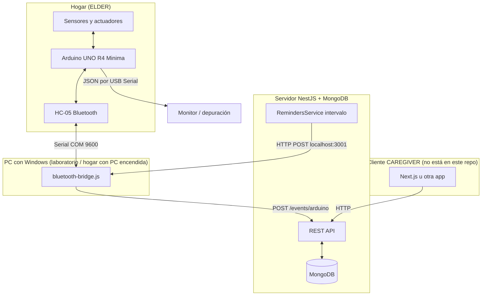

# Flujo completo del sistema HCI (Vínculo pasivo)

Este documento describe **de extremo a extremo** el funcionamiento del proyecto: firmware del Arduino UNO R4 Minima, puentes de comunicación, backend NestJS con MongoDB, recordatorios hacia el hardware, y el rol previsto del frontend. Está alineado con el código del repositorio `hci-backend` (ruta principal del sketch: `arduino_programs/ArduinoUnoR4Minima/ArduinoUnoR4Minima.ino`).

---

## 1. Propósito del sistema

El sistema intenta **acompañar a un adulto mayor (ELDER)** sin obligarlo a usar pantallas complejas: los sensores están embebidos en objetos cotidianos (sofá, cocina, pastillero, tótem). Los eventos suben a un servidor donde una **cuidadora (CAREGIVER)** puede revisar historial, patrones y un resumen tipo “dashboard”.

La identidad del anciano en la red **no viaja en claro** en cada paquete del hardware: solo un **token de vinculación** (`pin_vinculacion` en MongoDB, p. ej. `CASA10`) que el backend resuelve a un `ObjectId` interno.

---

## 2. Vista de capas (físico → lógico)



**Nota sobre la documentación histórica:** En `docs/HARDWARE_ARCHITECTURE.md` y `CIRCUIT_CONNECTIONS.md` se describe también un **ESP8266** que lee el UART del Arduino y hace `POST` por Wi‑Fi. Esa topología es válida como diseño alternativo. **En este repositorio**, el camino implementado y documentado en código es **HC-05 + `bluetooth-bridge.js`**: el PC recibe JSON por el puerto COM del Bluetooth y lo reenvía a NestJS.

---

## 3. Arduino: hardware por pin

Tabla basada en las constantes del sketch `ArduinoUnoR4Minima.ino`.

| Pin / bus | Componente | Dirección | Uso |
|-----------|------------|-----------|-----|
| D2 | Touch capacitivo (tótem) | Entrada digital | Ritual de bienestar, confirmación de recordatorios MED/ACT, fases de medicación. |
| D3 | PIR | Entrada digital | Detección de movimiento en sala (lógica con calibración inicial y “pausa” tras LOW). |
| D4 | SW-420 vibración (pastillero) | Entrada digital | Confirmación de toma por vibración; muestreo en `pollVibrationSensitive()`. |
| D5 | — | Libre en comentario | Reservado / no usado en el listado actual. |
| D6 | HC-SR04 TRIG (sofá) | Salida | Pulso ultrasónico. |
| D7 | HC-SR04 ECHO (sofá) | Entrada | Eco; `pulseIn` con timeout 25 ms. |
| D8–D10 | RTC DS1302 CLK/DAT/RST | — | Cableado previsto; la instancia `virtuabotixRTC` está comentada: **el RTC no gobierna la hora del sistema** en el firmware actual. |
| D11–D13 | LEDs semáforo R / Y / G | Salida | Feedback visual global y durante notificaciones. |
| A1 | Potenciómetro | Entrada analógica | Declarado; **no aparece en la lógica del `loop` actual** (posible simulador de tiempo futuro). |
| A2 | Buzzer pasivo | Salida | `tone()` para alertas y confirmaciones. |
| I2C (A4 SDA, A5 SCL) | LCD 1602 I2C (0x27), VL53L0X, MAX30105, MPU6050 | Bus | Varios dispositivos en el mismo bus I2C con direcciones distintas. |

**UART**

- `Serial` a **115200 baudios**: depuración USB y misma línea JSON que se puede ver en el Monitor Serie.
- `Serial1` a **9600 baudios**: canal hacia el **HC-05** (TX/RX del Arduino en 0/1 según comentario del sketch: conviene no usar esos pines para otros fines cuando el Bluetooth está cableado).

---

## 4. Arduino: inicialización (`setup`)

Orden aproximado y efectos:

1. **Serial y Serial1** arrancan a las velocidades indicadas.
2. **LCD**: `init`, `backlight`, mensaje “Iniciando… / Sistema HCI”.
3. **PinMode** de entradas (touch, PIR, vibración, echo), salidas (trig, LEDs, buzzer), lectura inicial del nivel del pin de vibración.
4. **Semáforo**: `updateGlobalTrafficLight()` según `dailyScore` (inicio 100 → verde).
5. **PIR**: bucle de **30 s** con `delay(1000)` — calibración bloqueante; durante ese tiempo el resto del sistema no avanza.
6. **lastResetTime** = `millis()` base para reset diario de 24 h.
7. **VL53L0X**: si `lox.begin()` falla, mensaje por Serial; si OK, `startRangeContinuous()`.
8. **MAX30105**: `begin` en `Wire` a velocidad I2C rápida; `setup` y amplitudes rojo/IR.
9. **MPU6050**: rango 4G, ancho de banda 21 Hz para suavizar; si falla, mensaje en LCD “ERR: MPU6050”.
10. Espera 2 s y LCD “Monitoreando / Actividad Abuelo”.

---

## 5. Arduino: temporizadores y constantes clave

| Constante | Valor | Significado |
|-----------|--------|----------------|
| `ONE_HOUR_MS` | 3 600 000 | Umbral de sedentarismo en el sofá (sentado continuo). |
| `RESET_TIME_MS` | 86 400 000 | 24 h: reinicio de flags diarios y `dailyScore`. |
| `DIST_SOFA_THRESHOLD` | 50.0 cm | Por debajo: considerado “sentado” para el HC-SR04 del sofá. |
| Calibración PIR | 30 s | Tiempo inicial antes de confiar en el PIR. |
| `pause` (PIR) | 5000 ms | Tras LOW del PIR, tiempo antes de considerar fin de movimiento (`lockLow`). |
| Umbral nevera (VL53L0X) | > 300 mm | Distancia grande ⇒ interpretación “puerta abierta” (umbral más sensible que doc antigua 50 cm). |
| `umbralPaso` (MPU) | 11.0 | Magnitud de aceleración sobre la que se cuenta un paso. |
| Anti-rebote paso | 500 ms | Mínimo entre dos pasos válidos. |
| Envío pasos | cada 2 pasos o flush impar | Si el total es impar y pasan ≥ 4 s sin nuevo paso, se envía el acumulado para no perder el último paso. |
| Telemetría BPM | cada ~22 s | Si `beatAvg` en rango plausible, evento `max30105` con `BPM_…`. |
| `delay` final del `loop` | 25 ms | Ritmo global del ciclo (~40 Hz teórico antes de contar el resto de trabajo). |

---

## 6. Arduino: función central `sendJsonEvent`

Firma (simplificada):

```cpp
void sendJsonEvent(String sensorId, String value, String module, String dataExtras = "");
```

**Cuerpo del JSON (estructura lógica)**

- `token`: cadena fija en firmware (ej. `"CASA10"`) — debe coincidir con `pin_vinculacion` de un usuario `ELDER` en MongoDB.
- `modulo`: uno de `"activity"`, `"medication"`, `"ritual"` (el bridge puede normalizar antes del POST; NestJS también canonicaliza).
- `data`: objeto embebido en string con:
  - `sensor_id`
  - `estado` (valor semántico)
  - campos extra si `dataExtras` no está vacío (fragmento JSON **sin** llaves externas; el sketch concatena pares como `"lugar":"sofa","fase":"sentado"`).

**Salida dual**

- `Serial.println(jsonPayload)` — USB.
- `Serial1.println(jsonPayload)` — Bluetooth al PC / bridge.

Si el bridge o el backend no están activos, los eventos se pierden en destino pero el Arduino sigue generándolos.

---

## 7. Arduino: lectura Bluetooth entrante (comandos del backend)

En cada vuelta del `loop`, un **bucle no bloqueante** lee `Serial1` carácter a carácter hasta `\n` o `\r`.

- Se acumula en `btBuffer` hasta fin de línea → `btCommandReady`.
- Si el mensaje contiene **`NOTIFY_MED`** o **`NOTIFY_ACT`**:
  - Se activa `isNotifying`, se resetean contadores de parpadeo/sonido.
  - **`NOTIFY_MED`**: `notifyType = "MED"`, fase 1, temporizadores de fase, LCD “Recordatorio MED / Toca TOTEM”, semáforo verde al inicio de fase 1, evento `medication_system` / `in_range` / módulo medication.
  - **`NOTIFY_ACT`**: `notifyType = "ACT"`, semáforo amarillo intermitente implícito en la rama ACT, LCD “Recordatorio: / Camina un poco!”.

Estos strings los **escribe** `bluetooth-bridge.js` cuando NestJS (vía cron de recordatorios) llama a `POST http://localhost:3001/notify`.

---

## 8. Arduino: máquina de estados de notificación MED

Cuando `isNotifying` y `notifyType == "MED"`:

**Fases activas (15 s cada una, repetibles hasta 3 fases)**

- Cada 500 ms alterna un LED “fantasma” (`ledYellowState`) pero aplicado a combinaciones distintas según `medPhase` (1: verde parpadeante; 2: amarillo; 3: rojo) vía `updateTrafficLight`.
- Cada 1.5 s suena un pitido corto (`tone` 1200 Hz, 100 ms).
- LCD: “Recordatorio MED / Presiona TOTEM”.

**Pausas (10 s) entre fases** (si `medPhase < 3`)

- Semáforo apagado; LCD “En pausa… / Presiona TOTEM”.
- Al terminar la pausa: `medPhase++`, y si pasó a fase 2 se envía evento `medication_system` / `second_attempt`.

**Si el usuario toca el tótem** (flanco LOW→HIGH en touch durante MED)

- Termina `isNotifying`, tonos de confirmación, LCD “Entendido! / Medicina Tomada”.
- Penalización a `dailyScore`: fase 1 → 0; fase 2 → −10; fase 3 → −20.
- Evento `touch_totem` con `estado` `taken_attempt_1|2|3`.

**Si termina la fase 3 sin interacción válida**

- `dailyScore -= 30`, evento `medication_system` / `schedule_passed_urgent`, se sale de notificación y se restaura semáforo global.

**Interacción con la vibración del pastillero**

- Si hay vibración mientras `isNotifying && MED`, solo se marca `vibrationDuringNotify` y se consume el flag **sin** tratar como “toma confirmada” duplicada inmediata (evita conflicto con el flujo del tótem).

---

## 9. Arduino: notificación ACT

- Parpadeo amarillo cada 500 ms; `blinkCount` incrementa; a los **20** ciclos de parpadeo se corta la notificación y vuelve el semáforo global.
- Un solo pitido inicial (800 Hz, 600 ms) cuando `soundCount == 0`.
- **Cancelación explícita** con touch (flanco LOW→HIGH): tonos de éxito, evento `touch_totem` / `reminder_acknowledged` / módulo `ritual`, LCD personalizado “Gracias Manuel”.

---

## 10. Arduino: casos de uso por sensor (resumen técnico)

### 10.1 Vibración pastillero (`VIB_MED_PIN`, SW-420)

- Función `pollVibrationSensitive()`: exige racha de lecturas HIGH (~14 consecutivas, ~350 ms acumulados en el peor caso dado el loop), flanco desde “no vibrando”, y **≥ 1200 ms** desde la última detección.
- Al procesar (fuera de la ventana de 2 ms post-golpe duplicado y no en medio de lógica conflictiva MED): LCD “Medicina OK”, beep positivo, `isTaken = true`, evento `vib_sensor` / `confirmed_taken` / `medication`.

### 10.2 Sofá ultrasónico

- `getDistance`: timeout 25 ms en `pulseIn`; si duration 0 → −1.
- Sentado: distancia > 0 y < 50 cm. Al entrar: evento `sesion_inicio` con extras lugar/fase.
- Si sigue sentado ≥ 1 h y aún no se envió alerta: semáforo amarillo, tono 440 Hz 2 s, LCD alerta, evento `sedentary_alert`.
- Al levantarse (distancia ≥ umbral): si estuvo sentado ≥ 3 s, evento `sesion_fin` con `duracion_seg`; restaura semáforo global y LCD por defecto.

### 10.3 PIR

- Modelo “lockLow / takeLowTime / lowIn / pause”: al HIGH, si `lockLow`, dispara movimiento, `movementCheckFullfilled = true`, evento `motion_detected`.
- Tras LOW sostenido más allá de `pause`, vuelve `lockLow` y `pirActive` false.

### 10.4 Nevera láser VL53L0X

- Si `lox.isRangeComplete()`, lee mm.
- Si > 300 mm: puerta abierta (marca tiempo de apertura).
- Al volver por debajo del umbral con puerta abierta previa: calcula segundos abiertos, marca `fridgeCheckFullfilled = true`, evento `fridge_laser` con estado `closed_duration_Xs`, breve LCD y delay.

### 10.5 Tótem (touch) fuera de notificaciones

- Flanco LOW→HIGH: beep, LCD “Todo Bien…”, `totemCheckFullfilled = true`.
- Estado enviado: `well_being_confirmed` o `well_being_BPM_{beatAvg}` si la media de BPM está en rango 35–200.
- Módulo `ritual`, extras con métrica y lugar.

### 10.6 MPU6050 (bastón / pasos)

- Magnitud \(\sqrt{x^2+y^2+z^2}\) del vector aceleración; comparación con `umbralPaso` y tiempo desde último paso.
- Eventos `mpu6050` con `estado` numérico de pasos acumulados y extras `origen: baston`, `metrica: pasos_acumulados`, módulo `activity`.

### 10.7 MAX30105 (ritmo)

- `checkForBeat` sobre IR; media móvil de últimos 4 BPM en `beatAvg`.
- Ritual y telemetría como en secciones anteriores.

### 10.8 Multi-evidencia (caso 7)

- Si en el día no se notificó aún (`!routineNotifiedToday`) y están los tres flags `movementCheckFullfilled`, `fridgeCheckFullfilled`, `totemCheckFullfilled`: un evento `multi_evidence_system` / `routine_completed_high_certainty` / `activity`, y se marca `routineNotifiedToday`.

### 10.9 Reset diario

- Cada 24 h: resetea flags de rutina, checks, `dailyScore` = 100, semáforo global, LCD “Nuevo Dia / Rutina Reiniciada”, delay 2 s.

---

## 11. Puente `bluetooth-bridge.js` (Node.js)

**Dependencias típicas:** `serialport`, `@serialport/parser-readline`, `axios`, `http` (core).

### 11.1 Configuración (editar en máquina real)

- `BLUETOOTH_COM_PORT`: p. ej. `'COM7'` — el puerto **saliente** del emparejamiento Bluetooth en Windows.
- `BAUDRATE`: **9600** — debe coincidir con `Serial1.begin(9600)` del Arduino.
- `BACKEND_URL`: por defecto `http://localhost:3000/events/arduino`.
- `BRIDGE_PORT`: **3001** — servidor HTTP local del bridge.

### 11.2 Flujo saliente (Arduino → NestJS)

1. Abre el puerto serie; pipe a `ReadlineParser` con delimitador `\n`.
2. Por cada línea: `trim`, ignorar vacías.
3. `JSON.parse`: si falla, ignora o registra error (filtra líneas de depuración que empiecen por `---`, `WIFI`, `!`).
4. **Mapeo de `modulo`**: convierte strings en minúsculas del sketch a mayúsculas del enum de Mongoose:

   | Entrada (Arduino / minúsculas) | Salida hacia API |
   |-------------------------------|------------------|
   | activity | ACTIVIDAD |
   | medication | MEDICACION |
   | ritual | RITUAL |
   | baston | ACTIVIDAD |

5. Si existe `payload.token`, `axios.post(BACKEND_URL, payload)`.

### 11.3 Flujo entrante (NestJS → Arduino)

1. `http.createServer` escucha `POST /notify` únicamente.
2. Body JSON: `{ "type": "MEDICACION" | "ACTIVIDAD" }` (el servicio de recordatorios usa esas cadenas).
3. Si el puerto está abierto:
   - `MEDICACION` → escribe `NOTIFY_MED\n` al serial.
   - `ACTIVIDAD` → escribe `NOTIFY_ACT\n`.
4. Usa `port.drain()` para asegurar vaciado del buffer hacia el HC-05.

**Condición operativa:** el PC debe estar encendido, el bridge ejecutándose, el Bluetooth emparejado y **nadie más** ocupando el mismo COM (p. ej. Monitor Serie del IDE en el mismo canal puede romper la comunicación).

---

## 12. Backend NestJS: módulos importados

`AppModule` registra:

- Conexión **Mongoose** a la base (URI debe configurarse de forma segura en producción; usar variables de entorno).
- `TestModule`, `UsersModule`, `PairingsModule`, `EventsModule`, `MedicationsModule`, `AnalyticsModule`, `RemindersModule`.

---

## 13. Modelo de datos (MongoDB / Mongoose)

### 13.1 Usuario (`users`)

Campos relevantes del esquema:

- `nombre`, `rol` (`CAREGIVER` | `ELDER`).
- `email`, `password` opcionales (login simple por email/password en `UsersService.login`).
- **`pin_vinculacion`**: token que el Arduino conoce; `UsersService.findByPin` lo usa en ingesta de eventos.

### 13.2 Pareja (`pairings`)

- `caregiver_id`, `elder_id` (ObjectId): establece permiso lógico de “esta cuidadora ve a este anciano”.

### 13.3 Evento (`events`)

- `elder_id` (ref User, requerido).
- **`modulo`** (enum en esquema): `'MEDICACION' | 'SEDENTARISMO' | 'RITUAL' | 'ACTIVIDAD'`.
- `data` (objeto libre): copia del subdocumento que venga en el POST (sensor_id, estado, extras).

Timestamps automáticos (`createdAt`, `updatedAt`) si están habilitados en el esquema global de Nest/Mongoose (el esquema usa `@Schema({ timestamps: true })`).

### 13.4 Canonicalización de módulo (`canonicalEventModulo`)

Archivo `src/common/event-modulo.util.ts`:

- Acepta mayúsculas ya válidas.
- Mapea sinónimos en minúsculas (`medication`, `activity`, `ritual`, `baston`, `sedentarismo`, etc.).
- **Por defecto** si no reconoce el valor: `'ACTIVIDAD'`.

**Detalle:** El enum del esquema incluye **`SEDENTARISMO`**, pero el firmware actual manda alertas de sofá bajo módulo **`activity`**. Esas alertas quedan como **`ACTIVIDAD`** con `data.sensor_id === 'sofa_ultrasonic'` y `data.estado === 'sedentary_alert'`. El dashboard en `AnalyticsService` detecta sedentarismo por esos campos, no solo por `modulo === 'SEDENTARISMO'`.

---

## 14. API REST relevante

### 14.1 Eventos

| Método | Ruta | Descripción |
|--------|------|-------------|
| POST | `/events/arduino` | Cuerpo: `{ token, modulo, data }`. Resuelve ELDER por pin, guarda evento. |
| GET | `/events/elder/:id` | Lista eventos por **ObjectId** del anciano, orden descendente por creación. |

Respuesta típica del POST: `{ success, mensaje, evento_id }`. Si el pin no existe: `404`.

### 14.2 Usuarios

| Método | Ruta | Notas |
|--------|------|--------|
| POST | `/users` | Alta usuario. |
| POST | `/users/login` | Body email/password. |
| GET | `/users`, `/users/:id`, `/users/:email` | **Ojo:** rutas parametrizadas pueden competir; el diseño actual conviene revisar en el front qué URL usa. |
| GET/PUT | `/users/:id/settings` | Respuesta simulada en controlador. |

### 14.3 Pairings

| Método | Ruta |
|--------|------|
| POST | `/pairings` — body `caregiver_id`, `elder_id` |
| GET | `/pairings` |

### 14.4 Medicaciones y recordatorios

| Recurso | Métodos |
|---------|---------|
| `/medications` | POST crear; GET `elder/:id`; PUT `:id`; DELETE `:id` |
| `/reminders` | POST crear; GET `:elderId`; PUT `:id`; DELETE `:id` |

Los esquemas guardan **`hora`** como string; el servicio de recordatorios hace **`startsWith`** contra `HH:mm` local del servidor donde corre NestJS.

### 14.5 Analytics

| GET | Comportamiento |
|-----|----------------|
| `/analytics/dashboard/:elderId` | **`getDashboard` usa `findByPin(elderId)`** — el parámetro de ruta se llama `elderId` pero en la implementación actual es el **PIN** (ej. `CASA10`), no el ObjectId. |
| `/analytics/patterns/:elderId` | Patrones (misma convención de parámetro en servicio). |
| `/analytics/timeline/:elderId` | Línea de tiempo. |
| `/analytics/routine/:elderId` | Rutina diaria. |

El dashboard agrega eventos del día, detecta alertas de medicación/sedentarismo, resume pasos desde eventos del bastón, PIR, nevera, sofá, etc. (ver `analytics.service.ts` para la lógica completa).

---

## 15. Recordatorios y cierre del bucle hacia el Arduino

Clase `RemindersService` (`OnModuleInit`):

1. Cada **15 segundos** ejecuta `checkReminders()`.
2. Construye `timeStr` como `HH:mm` en hora local del proceso Node.
3. Evita re-disparar el mismo minuto con `lastTriggeredMinute`.
4. Carga todos los documentos de `reminders` y `medications`.
5. Para cada recordatorio cuya `hora` **empiece por** `timeStr`, infiere tipo:
   - Si la descripción de actividad contiene “medic”, “pastill” o “dosis” → tipo **MEDICACION**; si no → **ACTIVIDAD**.
6. Cada medicación cuya `hora` coincida → notificación **MEDICACION**.
7. Si hay cola de notificaciones, las envía con **`setTimeout` escalonado de 15 s** entre una y otra para no saturar al anciano ni al serial.
8. `fetch('http://localhost:3001/notify', { method: 'POST', body: JSON.stringify({ type: notif.tipo }) })`.

**Cadena completa:** MongoDB (hora programada) → NestJS cron → bridge puerto 3001 → COM Bluetooth → Arduino `Serial1` → líneas `NOTIFY_*` → feedback local (LCD, LEDs, buzzer).

---

## 16. Frontend (diseño previsto; no alojado en este repo)

Según `docs/SOFTWARE_ARCHITECTURE.md`, la app de la cuidadora (ej. **Next.js**) sería un **consumidor de API**:

1. Login → obtiene identidad CAREGIVER.
2. `GET /pairings` (filtrando en cliente o ampliando el backend según diseño) para saber qué `elder_id` o pin usar.
3. `GET /events/elder/{id}` para historial si se usa ObjectId.
4. Para el dashboard enriquecido del código actual: **`GET /analytics/dashboard/{pin}`** con el pin de vinculación, dado que el servicio resuelve por pin.

La UI puede cambiar colores según último evento o según el objeto agregado del dashboard (verdes, alertas suaves de sedentarismo, etc.).

**Tiempo real:** la documentación menciona WebSockets/Socket.io como mejora; el backend actual no lo incluye en los archivos listados: el front típicamente haría **polling** periódico a `/events/elder/...` o `/analytics/dashboard/...`.

---

## 17. Tabla de referencia rápida: `sensor_id` / estados frecuentes

| sensor_id (típico) | estado (ejemplos) | modulo en firmware |
|--------------------|-------------------|---------------------|
| vib_sensor | confirmed_taken | medication |
| sofa_ultrasonic | sesion_inicio, sedentary_alert, sesion_fin | activity |
| pir_sensor | motion_detected | activity |
| fridge_laser | closed_duration_Xs | activity |
| touch_totem | well_being_*, reminder_acknowledged, taken_attempt_* | ritual / medication |
| mpu6050 | número pasos | activity |
| max30105 | BPM_n | ritual |
| medication_system | in_range, second_attempt, schedule_passed_urgent | medication |
| multi_evidence_system | routine_completed_high_certainty | activity |

---

## 18. Seguridad y operación

- El **token en el firmware** es visible a quien lea el `.ino` o el binario; en un despliegue real conviene **provisionar** el pin por EEPROM/configuración sin hardcodear en repo público.
- La **URI de MongoDB** no debe permanecer en código fuente versionado; usar `.env` y secretos en CI/CD.
- El bridge y NestJS asumen **localhost**; en red doméstica o nube habría que sustituir URLs y asegurar TLS/autenticación entre bridge y API.

---

## 19. Cómo levantar el sistema en desarrollo (orden sugerido)

1. MongoDB accesible con la misma URI configurada en la app (o ajustar configuración).
2. `npm install` en la raíz del backend; `npm run start:dev`.
3. Emparejar HC-05; identificar COM saliente.
4. Editar `bluetooth-bridge.js` con el COM correcto; `node bluetooth-bridge.js`.
5. Alimentar el Arduino; verificar JSON en Monitor Serie (115200) y recepción en consola del bridge.
6. Poblar usuarios ELDER con `pin_vinculacion` coincidente con el `token` del sketch.
7. Crear recordatorios/medicaciones con hora próxima para probar `NOTIFY_MED` / `NOTIFY_ACT`.

---

## 20. Archivos clave del repositorio

| Ruta | Rol |
|------|-----|
| `arduino_programs/ArduinoUnoR4Minima/ArduinoUnoR4Minima.ino` | Firmware completo. |
| `bluetooth-bridge.js` | Puente COM ↔ NestJS ↔ comandos notify. |
| `src/events/*` | Ingesta Arduino y listado por anciano. |
| `src/reminders/reminders.service.ts` | Cron y llamada al bridge. |
| `src/common/event-modulo.util.ts` | Normalización de módulos. |
| `src/analytics/analytics.service.ts` | Agregación para UI tipo dashboard. |
| `docs/SOFTWARE_ARCHITECTURE.md` | Visión producto / Next.js. |
| `docs/HARDWARE_ARCHITECTURE.md` | Visión hardware (incluye variante ESP8266). |
| `docs/CIRCUIT_CONNECTIONS.md` | Cableado físico detallado. |

---

*Documento generado para el equipo HCI; mantener sincronizado con cambios en firmware y contratos de API.*
